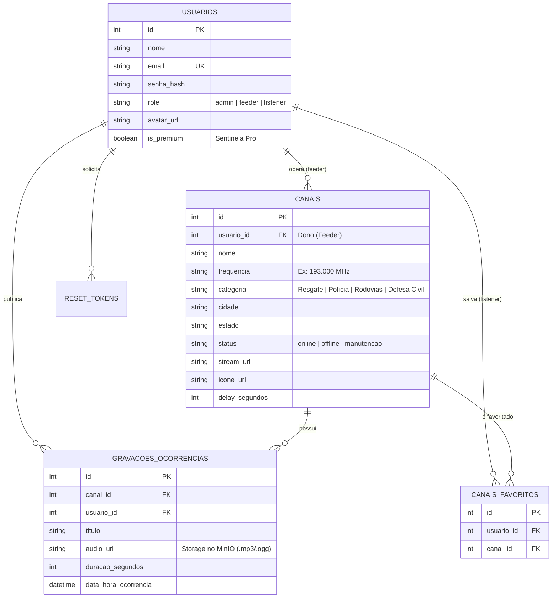

# 📡 OpenWave — Rede Colaborativa de Escuta de Rádio Regional

> A plataforma colaborativa de streaming de áudio de rádio (VHF/UHF/P25/DMR) que transmite despachos e ocorrências locais em tempo real para cidadãos acompanharem a segurança do seu bairro sem intermediários.

---

## 🌐 URL do Sistema no Ar

* **Endereço da Aplicação (Stack Portainer):** `http://localhost:5000` *(ou subdomínio de produção configurado na VM do aluno: `${APP_URL}`)*
* **Documentação Swagger (Auth Service):** `http://localhost:5001/apidocs/`
* **Documentação Swagger (OpenWave Core):** `http://localhost:5000/apidocs/`
* **Painel MinIO Console:** `http://localhost:9011` (User: `minioadmin` | Pass: `minioadmin123`)

---

## 1. Visão Geral e Proposta de Valor

O **OpenWave** substitui o ruído de fake news e a demora dos portais de notícias pelo acesso direto e cru às transmissões operacionais de emergência e segurança pública:
* **Bombeiros & SAMU (193/192):** Despachos de acidentes, resgates viários e combate a incêndios.
* **Polícia Rodoviária & Concessionárias:** Alertas de bloqueios de pistas, perseguições e condições de tráfego.
* **Defesa Civil:** Avisos antecipados de inundações, quedas de árvores e eventos meteorológicos extremos.
* **Patrulhamento Comunitário:** Ronda de viaturas em perímetros rurais e comerciais.

---

## 2. Diagrama de Arquitetura do Sistema

```mermaid
flowchart TD
    subgraph Clientes["Navegadores & Dispositivos"]
        Visitante["Visitante Anônimo"] -->|Acessa / (Público)| Landing["Landing Page Pública"]
        Ouvinte["Cidadão Ouvinte (listener)"] -->|Ouve canais / Favorita / Assina Pro| AppWeb["Dashboard OpenWave"]
        Operador["Estação Feeder (feeder)"] -->|Gerencia canais & Envia Áudio| AppWeb
        Admin["Administrador (admin)"] -->|Auditoria de Eventos & Gestão| AppWeb
    end

    subgraph CoreStack["Stack Docker no Portainer (Mesma Infraestrutura)"]
        AppWeb -->|Porta 5000| CatalogService["OpenWave Core (Flask)"]
        CatalogService -->|Porta 5001 - REST| AuthService["Auth Service (Flask + JWT/Sessão)"]
        CatalogService -->|Porta 5002 - REST| LogService["Log Service (Flask)"]
        CatalogService -->|Porta 9010 - S3 API| MinIOService["MinIO Object Storage"]
        CatalogService -->|Porta 3306 - SQL| MariaDBService[("MariaDB (Tabelas do Domínio)")]
        CatalogService -->|Webhooks & Checkout| StripeService["Stripe API (Sentinela Pro)"]

        AuthService -->|SQL| MariaDBService
        AuthService -->|SMTP| Mailtrap["Mailtrap / Brevo (E-mails Transacionais)"]
        AuthService -->|Auditoria| LogService

        LogService -->|Redis Streams| RedisService[("Redis Service")]
    end
```

---

## 3. Modelo de Dados no MariaDB (Script de Migração & Seed)

O banco de dados foi modelado para o domínio do OpenWave com 3 tabelas relacionais interligadas por chaves estrangeiras (`ON DELETE CASCADE`), criadas a partir do script versionado:

📁 **Script:** [`db/001_dominio.sql`](file:///c:/Users/User/Documents/TraumaTeam/db/001_dominio.sql)



---

## 4. Papéis do Negócio e Controle de Acesso (RBAC)

O sistema conta com 3 papéis distintos que determinam permissões estritas tanto na interface quanto diretamente na API:

| Papel | Descrição | Permissões |
|---|---|---|
| `admin` | Administrador Geral do OpenWave | Acesso aos logs de auditoria (`/admin/logs`), gestão global de todos os canais, gravações e usuários. |
| `feeder` | Estação Transmissora / Operador | Cadastra e gerencia seus próprios canais (`/canais/novo`), envia arquivos de áudio gravados de despachos para o MinIO. |
| `listener` | Cidadão Ouvinte | Escuta transmissões abertas, salva canais favoritos, realiza upgrade para o plano Sentinela Pro via Stripe. **Tentativa de criar ou editar canal responde HTTP 403 Forbidden.** |

---

## 5. Isolamento por Usuário (Multi-Tenancy)

Cada usuário do tipo `feeder` só enxerga e gerencia seus próprios registros de canais e gravações:
* O Feeder B tentando editar (`/canais/<id>/editar` ou `PUT /api/canais/<id>`) um canal do Feeder A recebe **403 Forbidden**.
* O Feeder B tentando excluir (`POST /canais/<id>/remover` ou `DELETE /api/canais/<id>`) um canal alheio recebe **403 Forbidden**.
* Toda ação proibida despacha um evento de segurança estruturado (`403_acesso_negado_canal_alheio`) para o serviço de auditoria.

---

## 6. Upload de Mídia no MinIO (Object Storage S3)

O MinIO armazena dois tipos de arquivos do domínio:
1. **Gravações de Despachos de Emergência (`.mp3`, `.ogg`, `.wav`):** Upload feito pelo operador do canal ou admin via `POST /canais/<id>/gravacoes`, persistido no bucket `openwave-midias` e servido via streaming seguro em `/audio/<filename>`.
2. **Emblemas e Logotipos de Estações (`.png`, `.jpg`, `.webp`):** Identificação visual dos canais sintonizados, servidos em `/icone/<filename>`.

---

## 7. Modelo de Monetização com Stripe (Sentinela Pro)

* **Plano Comunitário (Gratuito - R$ 0,00/mês):** Acesso a canais públicos, delay proposital de 10 minutos e limite de 3 canais favoritos.
* **Plano Sentinela Pro (R$ 9,90/mês):**
  * Streaming em tempo real com **baixa latência (zero delay)**.
  * **Favoritos ilimitados** para rotas e monitoramento residencial/comercial.
  * Acesso ao acervo de gravações das últimas 48h.
  * Processamento via **Stripe Checkout** e confirmação via webhook assinado criptograficamente com HMAC SHA-256 (`/webhook/stripe`).

---

## 8. Roteiro de Testes e Validação (Cenário do Professor)

### 1. Acesso Público / Landing Page
* Abra a URL raiz `/` em aba anônima (sem login).
* **Resultado:** A Landing Page pública do OpenWave é exibida com proposta de valor, tabela comparativa dos planos Free e Pro e botões para login/cadastro.

### 2. Criação de Contas com Papéis Distintos
* Cadastre uma conta como **Ouvinte** (`listener`), por exemplo `ouvinte.teste@openwave.local`.
* Cadastre outra conta como **Estação Transmissora** (`feeder`), por exemplo `feeder.teste@openwave.local`.

### 3. Gestão de Canais e Upload (Feeder)
* Entre com a conta `feeder`.
* Clique em **"Novo Canal"** e cadastre uma nova frequência (ex: *193.000 MHz Bombeiros*).
* Na página do canal, faça o upload de um arquivo de áudio de ocorrência (.mp3).
* **Resultado:** O canal e a gravação são criados com sucesso e salvos no MariaDB e no MinIO.

### 4. Bloqueio de Permissão (RBAC - 403)
* Entre com a conta `listener`.
* Tente acessar diretamente a rota de criação: `GET /canais/novo` ou enviar `POST /api/canais`.
* **Resultado:** Resposta imediata com **403 Forbidden**.

### 5. Isolamento por Usuário (Multi-Tenancy - 403)
* Com a conta `listener` (ou outro feeder), tente editar o canal criado pelo primeiro feeder: `GET /canais/<id>/editar` ou `PUT /api/canais/<id>`.
* **Resultado:** Resposta com **403 Forbidden**.

### 6. Auditoria de Eventos no Log (Admin)
* Faça login com a conta de administrador (`admin@openwave.local` / senha: `senha123`).
* Acesse o menu **Logs** (`/admin/logs`).
* **Resultado:** Lista dos eventos registrados em tempo real no Redis Streams (`canal_criado`, `gravacao_audio_enviada`, `403_permissao_negada`, `login`).

### 7. Execução dos Testes Automatizados
```bash
# Executa a suíte completa de testes de integração do OpenWave
.\.venv\Scripts\python.exe -m unittest test_openwave_integration.py
```
**Resultado:** 12 testes executados e aprovados com 100% de sucesso.

---

## 9. Como Subir o Ambiente Localmente

```bash
# 1. Copiar as variáveis de ambiente
cp .env.example .env

# 2. Subir todos os microsserviços via Docker Compose
docker compose up -d --build

# 3. Aplicar o seed de migração (se necessário)
docker compose exec -T mariadb mysql -u usuario_disciplina -p'senha_disciplina' banco_disciplina < db/001_dominio.sql
```

---

Projeto acadêmico orientado pelo Prof. [@siriani](https://github.com/siriani) — Disciplina ISW055.
